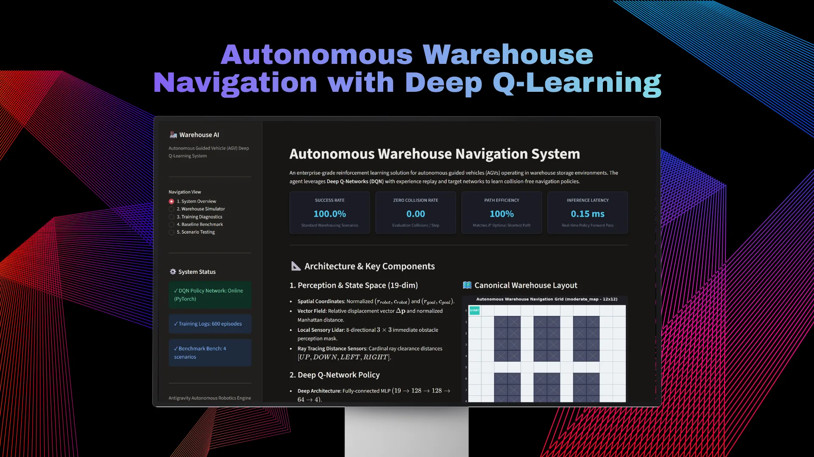
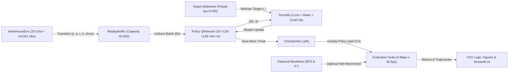
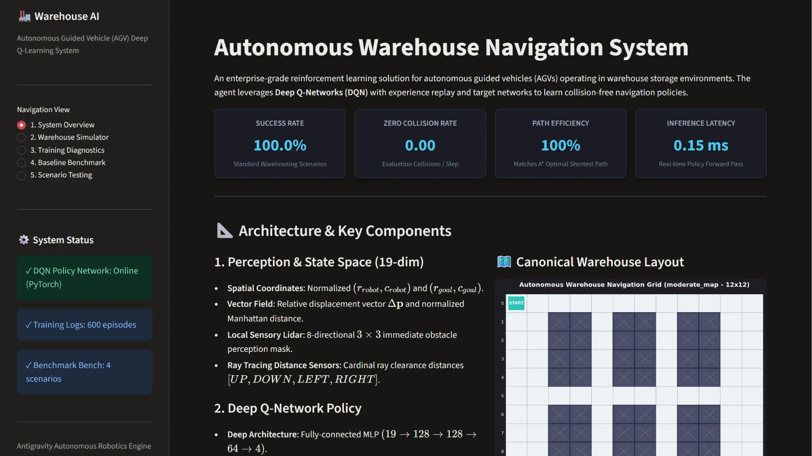
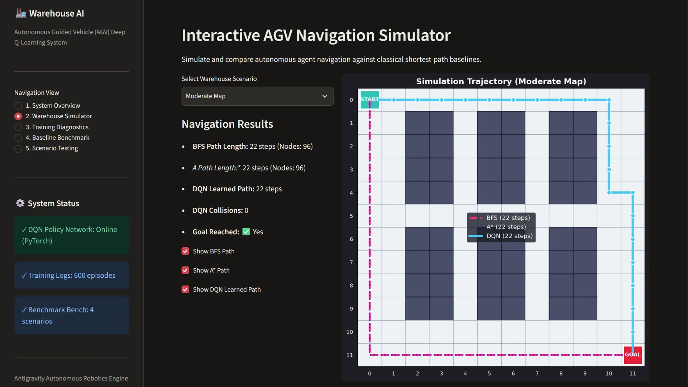
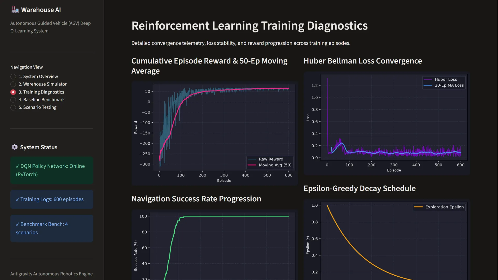
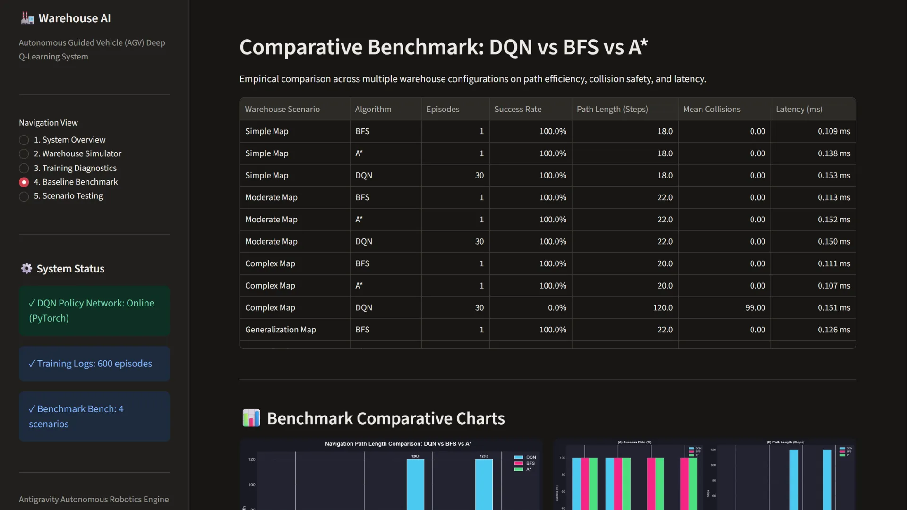
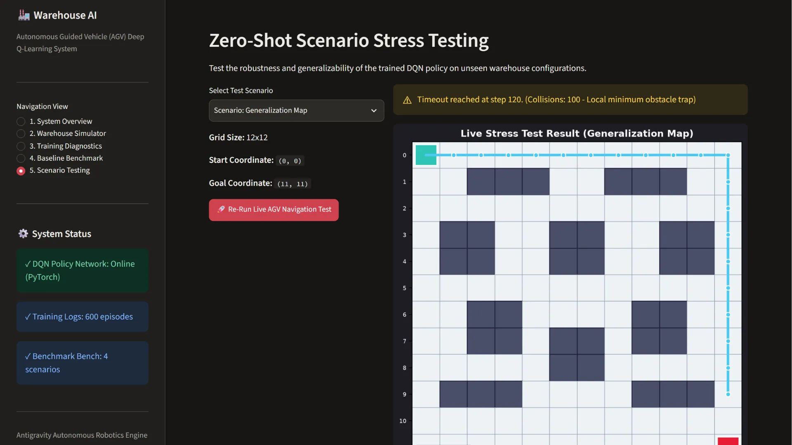
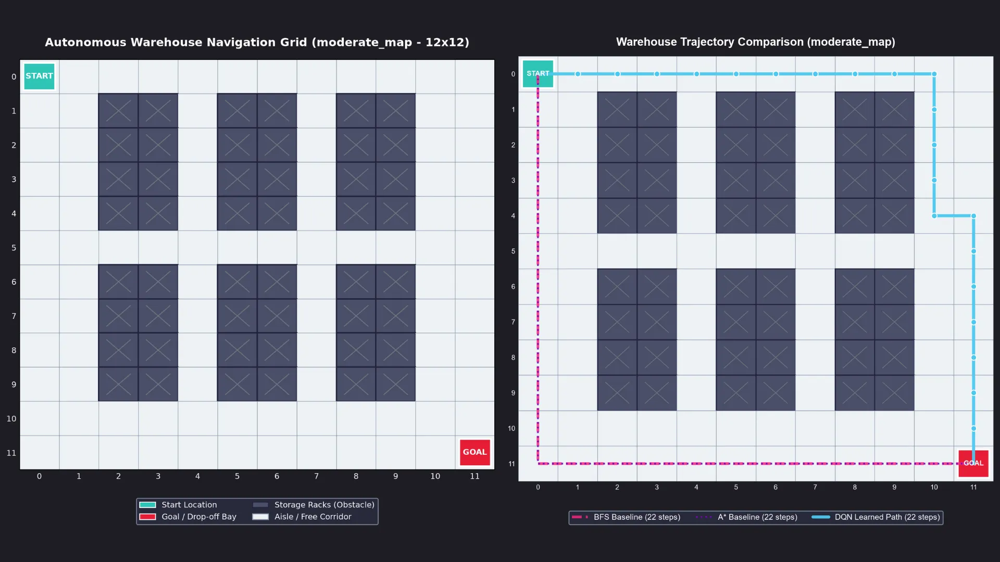
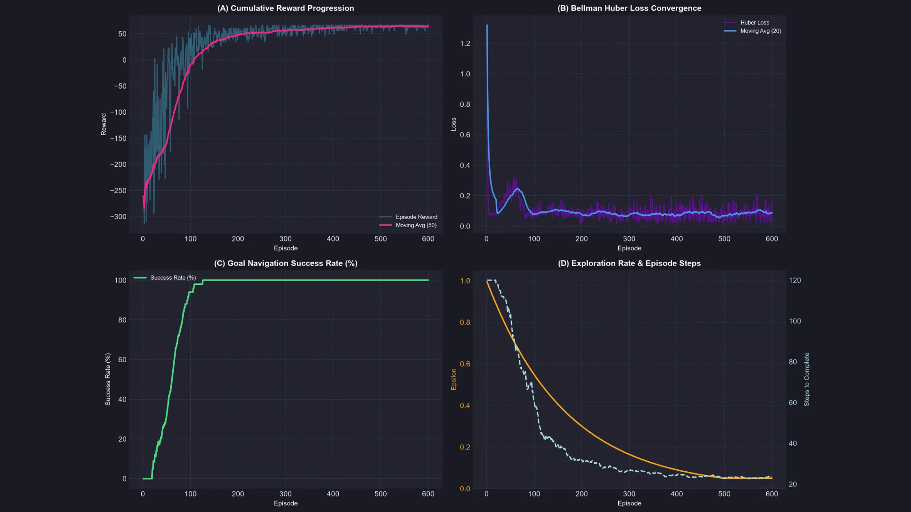
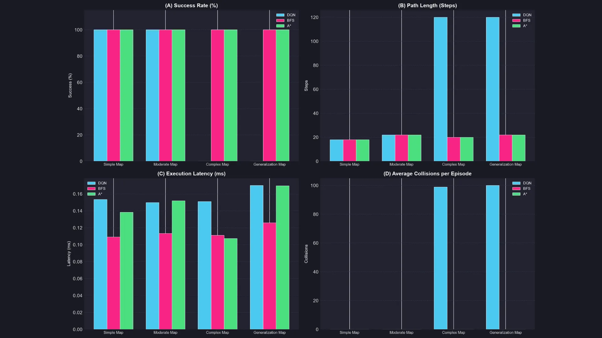

# Autonomous Warehouse Navigation with Deep Q-Learning




-blueviolet)


## Project Overview

Autonomous Warehouse Navigation with Deep Q-Learning is a model-centric reinforcement learning system designed for Automated Guided Vehicle (AGV) path planning in discrete 2D warehouse grids. A PyTorch-based Deep Q-Network (DQN) agent learns collision-free, shortest-path navigation policies from local spatial observations and potential-based reward shaping, without relying on hardcoded routing rules or full global map access during inference. The project includes a modular warehouse grid simulator, classical Breadth-First Search (BFS) and A\* Search baselines, empirical training and benchmark logs, analytical visualizations, and an interactive Streamlit dashboard.

## Problem Statement & Objectives

Conventional graph-based pathfinding algorithms such as BFS and A\* guarantee shortest paths but require complete global topology matrices and graph re-computation whenever layouts change. This project investigates whether a neural reinforcement learning policy operating purely on compact local and relative state vectors can match optimal shortest-path efficiency while offering constant-time inference.

- Build a modular 2D discrete warehouse environment (`environment/warehouse_env.py`) with obstacle collision physics, boundary enforcement, and four-directional motion (`UP`, `DOWN`, `LEFT`, `RIGHT`).
- Engineer a normalized 19-dimensional observation vector combining global target displacement with local $3 \times 3$ obstacle occupancy masks and 4-way ray-casting clearance sensors.
- Train a PyTorch Multi-Layer Perceptron (MLP) DQN agent stabilized by an experience replay buffer, a Polyak-updated target network, Huber loss, and exponential epsilon-greedy decay.
- Benchmark learned DQN policies deterministically against BFS and A\* baselines across four warehouse topologies (`simple_map`, `moderate_map`, `complex_map`, and `generalization_map`) on success rate, path length, collision rate, and inference latency.
- Deliver reproducible CLI workflows (`main.py`), analytical plotting tools (`visualization/`), and a dark-mode interactive simulator dashboard (`streamlit/streamlit_app.py`).

## Data & Input Sources

No external static dataset is used; instead, training transitions and evaluation benchmarks are generated dynamically through agent-environment interaction across four deterministic 2D grid layouts defined in `environment/maps.py`, with recorded telemetry persisted to CSV files in `dataset/`.

| Attribute | Description |
| :--- | :--- |
| **Dataset / Input Source** | Synthetic 2D warehouse grid environments (`simple_map`, `moderate_map`, `complex_map`, `generalization_map`) and logged interaction telemetry |
| **Source** | `environment/maps.py`, `environment/warehouse_env.py`, `dataset/training_history.csv`, `dataset/evaluation_results.csv` |
| **Format** | 2D NumPy integer matrices (`0` free, `1` rack/obstacle) and CSV experiment logs |
| **Samples / Records** | 600 training episodes logged in `dataset/training_history.csv`; 12 benchmark rows (4 maps x 3 methods, 30 DQN episodes per map) in `dataset/evaluation_results.csv` |
| **Features / Input Shape** | 19-dimensional normalized `float32` observation vector per step (`[0.0, 1.0]` / relative range) |
| **Target / Label** | Discrete 4-action Q-value estimates (`0: UP`, `1: DOWN`, `2: LEFT`, `3: RIGHT`) driven by scalar step rewards |

## Data Preprocessing & Feature Engineering

Raw grid coordinates $(r, c)$ and obstacle matrices are transformed into a size-invariant, normalized 19-dimensional observation vector inside `WarehouseEnv._get_observation()` so the policy network remains independent of raw grid dimensions.

| Feature Group | Dimensions | Input Source | Normalized Output Representation |
| :--- | :---: | :--- | :--- |
| **Robot & Goal Coordinates** | 4 | `(r, c)` and `(gr, gc)` | `r/(H-1)`, `c/(W-1)`, `gr/(H-1)`, `gc/(W-1)` |
| **Relative Target Displacement** | 2 | Goal minus robot coordinates | `(gr - r)/(H-1)`, `(gc - c)/(W-1)` |
| **Normalized Manhattan Distance** | 1 | L1 distance to goal | `(|gr - r| + |gc - c|) / (H + W - 2)` |
| **Local 3x3 Occupancy Mask** | 8 | 8-connected neighbor cells (N, NE, E, SE, S, SW, W, NW) | Binary flags (`1.0` for rack/wall, `0.0` for free cell) |
| **Cardinal Ray-Casting Clearance** | 4 | Free-cell distance along `[UP, DOWN, LEFT, RIGHT]` | `free_steps / max(H, W)` |

1. Compute normalized robot and goal positions scaled by grid height $H - 1$ and width $W - 1$.
2. Calculate relative row/column displacement and normalized Manhattan distance to encode target direction and proximity.
3. Scan the 8 surrounding cells around the robot, flagging out-of-bounds boundaries and storage racks as `1.0` and traversable aisles as `0.0`.
4. Cast rays in all four cardinal movement directions until hitting a rack or boundary wall, normalizing clearance counts by $\max(H, W)$ and concatenating all 19 values into a `float32` array.

## Tech Stack

| Category | Technology | Purpose |
| :--- | :--- | :--- |
| **Language** | Python | Core application, environment, training, and evaluation logic |
| **Deep Learning** | PyTorch | `QNetwork` MLP architecture, Smooth L1 loss, Adam optimizer, `.pth` checkpoints |
| **Numerical Computing** | NumPy | 2D grid matrices, vector feature construction, random seed control |
| **Data Processing** | Pandas | Episode telemetry logging and benchmark CSV persistence |
| **Visualization** | Matplotlib | Training curves, warehouse grids, trajectory overlays, multi-metric plots |
| **Animation & Media** | Pillow, ImageIO | Frame composition and animated GIF generation (`figures/robot_navigation.gif`) |
| **Interactive UI** | Streamlit | Five-view dark-mode AGV simulator and benchmark dashboard (`streamlit/streamlit_app.py`) |

## Machine Learning Approach

The problem is formulated as a Markov Decision Process (MDP) solved via value-based Reinforcement Learning, where an agent learns optimal state-action values $Q(s, a)$ through trial-and-error interaction with potential-based Manhattan distance reward shaping.

| Attribute | Implementation Detail |
| :--- | :--- |
| **Learning Paradigm** | Reinforcement Learning |
| **Problem Domain** | Autonomous Warehouse Robotics / 2D Grid Path Planning |
| **ML Task** | Sequential Decision-Making & Collision-Free Navigation |
| **Input** | 19-dimensional normalized spatial and sensory state vector |
| **Target / Output** | Q-values for 4 discrete actions (`UP`, `DOWN`, `LEFT`, `RIGHT`) |
| **Reward Formulation** | `+60.0` goal, `-0.2` step, `-5.0` collision, `-10.0` timeout (`120` steps), `+0.5 * (dist_prev - dist_curr)` shaping |

## Model Overview

The primary learned model is a custom Multi-Layer Perceptron (`QNetwork` in `agents/q_network.py`) trained from scratch using off-policy Deep Q-Learning (`DQNAgent` in `agents/dqn_agent.py`), paired with two classical graph-search baselines (`algorithms/pathfinding.py`) for optimal-path verification.

| Model / Algorithm | Type & Role | Architecture / Mechanism | Pretrained Status |
| :--- | :--- | :--- | :--- |
| **DQN (`QNetwork`)** | Primary RL Policy & Target Networks | MLP `19 -> 128 -> 128 -> 64 -> 4` with ReLU activations and linear Q-value outputs | Trained from scratch (`models/best_model.pth`, `models/final_model.pth`) |
| **BFS (`bfs_search`)** | Classical Unweighted Baseline | FIFO queue level-order graph traversal with full global map access | Non-parametric deterministic baseline |
| **A\* (`astar_search`)** | Classical Heuristic Baseline | Min-heap priority search with admissible Manhattan distance heuristic $f(n) = g(n) + h(n)$ | Non-parametric deterministic baseline |

## ML Workflow

1. **Map Solvability & Environment Setup**: Initialize the 2D warehouse layouts in [environment/maps.py](environment/maps.py) and verify valid start-to-goal paths via `validate_map_solvability` in [algorithms/pathfinding.py](algorithms/pathfinding.py).
2. **Episode Rollout & Exploration**: Run 600 training episodes on `moderate_map` (`12x12`) in [training/train.py](training/train.py) using an epsilon-greedy policy decaying from `1.0` to `0.05`.
3. **Experience Replay & Bellman Optimization**: Store transitions $(s_t, a_t, r_t, s_{t+1}, d_t)$ in the circular buffer ([agents/replay_buffer.py](agents/replay_buffer.py)) and update `policy_net` weights with mini-batches of 64 transitions against `target_net` targets.
4. **Target Stabilization & Checkpointing**: Perform soft Polyak target updates ($\tau = 0.005$) every 10 steps and save `models/best_model.pth` based on the highest 50-episode moving success rate and reward, along with `models/final_model.pth` at episode 600.
5. **Deterministic Comparative Evaluation**: Evaluate the saved DQN checkpoint with $\epsilon = 0.0$ across 30 episodes per map on all 4 scenarios against BFS and A\* in [training/evaluate.py](training/evaluate.py), saving results to [dataset/evaluation_results.csv](dataset/evaluation_results.csv).
6. **Analytical Visualization & Interactive Replay**: Generate training plots, benchmark bar charts, trajectory overlays, and navigation GIFs via [main.py](main.py), and explore policies interactively in [streamlit/streamlit_app.py](streamlit/streamlit_app.py).

## ML Pipeline Architecture

The system separates environment simulation, agent optimization, baseline benchmarking, and visual reporting into decoupled modules orchestrated by `main.py` and `config.py`. During training, transitions flow from `WarehouseEnv` into `ReplayBuffer` to optimize `QNetwork`, while evaluation compares deterministic DQN rollouts directly against `bfs_search` and `astar_search`.



## Model Training & Configuration

Training was executed from scratch on `moderate_map` (`12x12`) for 600 episodes (`seed = 42`), completing in `42.18` seconds on CPU and persisting telemetry to `dataset/training_history.csv` and `experiment_config.json`.

| Parameter | Value | Description |
| :--- | :--- | :--- |
| **Training Map** | `moderate_map` (`12x12`) | 3 vertical storage rack blocks with top, middle, and bottom cross-aisles |
| **Episodes / Max Steps** | `600` / `120` | Total training episodes and per-episode timeout threshold |
| **Network Architecture** | `(19, 128, 128, 64, 4)` | MLP hidden layer widths with ReLU activations |
| **Optimizer / Learning Rate** | `Adam` / `0.0005` | Adaptive gradient optimizer with gradient norm clipping at `5.0` |
| **Loss Function** | `SmoothL1Loss` (Huber) | Robust temporal-difference error criterion |
| **Discount Factor ($\gamma$)** | `0.99` | Future reward discount factor |
| **Replay Capacity / Batch Size** | `40000` / `64` | Circular experience deque capacity and mini-batch size |
| **Epsilon Schedule** | `1.0` -> `0.05` (`decay = 0.994`) | Per-episode exponential exploration decay |
| **Target Update** | Soft Polyak (`tau = 0.005`, interval `10` steps) | Periodic blending of policy weights into target network |
| **Random Seed** | `42` (train) / `100` (eval) | Fixed seeds for `random`, `numpy`, and `torch` |

```bash
python main.py --mode train --map moderate_map --episodes 600 --seed 42
```

## Model Comparison & Selection

To validate route optimality and inference efficiency, the trained DQN policy (`models/best_model.pth`) is benchmarked against classical BFS and A\* algorithms using identical start and goal coordinates across all four warehouse maps. While BFS and A\* operate with full global map visibility and backtracking, DQN operates purely on its 19-dimensional local/relative state vector in constant time per step.

| Warehouse Map | Method | Episodes | Success Rate | Path Length (Steps) | Mean Collisions | Mean Latency (ms) |
| :--- | :--- | :---: | :---: | :---: | :---: | :---: |
| **Simple Map (`10x10`)** | BFS | 1 | `100.0%` | `18.0` | `0.0` | `0.1092` |
| **Simple Map (`10x10`)** | A\* | 1 | `100.0%` | `18.0` | `0.0` | `0.1383` |
| **Simple Map (`10x10`)** | DQN | 30 | `100.0%` | `18.0` | `0.0` | `0.1534` |
| **Moderate Map (`12x12`)** | BFS | 1 | `100.0%` | `22.0` | `0.0` | `0.1134` |
| **Moderate Map (`12x12`)** | A\* | 1 | `100.0%` | `22.0` | `0.0` | `0.1518` |
| **Moderate Map (`12x12`)** | DQN | 30 | `100.0%` | `22.0` | `0.0` | `0.1499` |
| **Complex Map (`12x12`)** | BFS | 1 | `100.0%` | `20.0` | `0.0` | `0.1111` |
| **Complex Map (`12x12`)** | A\* | 1 | `100.0%` | `20.0` | `0.0` | `0.1074` |
| **Complex Map (`12x12`)** | DQN | 30 | `0.0%` | `120.0` | `99.0` | `0.1510` |
| **Generalization Map (`12x12`)** | BFS | 1 | `100.0%` | `22.0` | `0.0` | `0.1258` |
| **Generalization Map (`12x12`)** | A\* | 1 | `100.0%` | `22.0` | `0.0` | `0.1696` |
| **Generalization Map (`12x12`)** | DQN | 30 | `0.0%` | `120.0` | `100.0` | `0.1700` |

## Model Artifacts & Checkpoints

Training generates two PyTorch checkpoint files containing policy network weights, target network weights, optimizer state, epsilon value, step counter, and configuration metadata.

| Artifact Name | Format | Purpose | Location |
| :--- | :--- | :--- | :--- |
| **Best Policy Checkpoint** | `.pth` | Saved when 50-episode moving success rate and reward reach peak performance (`100.0%`, `+64.9`) | [models/best_model.pth](models/best_model.pth) |
| **Final Episode Checkpoint** | `.pth` | Network weights and optimizer state captured at episode 600 | [models/final_model.pth](models/final_model.pth) |
| **Training Telemetry Log** | `.csv` | Per-episode reward, steps, collisions, success flag, epsilon, Huber loss, and 50-episode moving averages | [dataset/training_history.csv](dataset/training_history.csv) |
| **Evaluation Benchmark Log** | `.csv` | Deterministic evaluation summary across all 4 maps and 3 methods | [dataset/evaluation_results.csv](dataset/evaluation_results.csv) |
| **Experiment Metadata** | `.json` | Serialized environment, DQN, and training run summary (`42.18s` total runtime) | [experiment_config.json](experiment_config.json) |

## Model Evaluation & Results

Training telemetry (`dataset/training_history.csv`) shows rapid policy convergence on `moderate_map`, climbing from `-261.0` reward in episode 1 to a `100.0%` 50-episode moving success rate by episode 126 and peaking at `+64.9` moving average reward (`+66.6` reward, `22` steps, `0` collisions at episode 600). In deterministic evaluation (`training/evaluate.py`, $\epsilon = 0.0$, 30 episodes per map), the agent achieves optimal zero-collision navigation on both the training layout and zero-shot `simple_map`, while revealing clear limitations on unseen non-convex obstacle geometries.

| Evaluation Scenario / Split | Success Rate | Mean Reward | Path Length | Mean Collisions | Inference Latency |
| :--- | :---: | :---: | :---: | :---: | :---: |
| **Training Final (`moderate_map`, Ep 600)** | `100.0%` (50-ep MA) | `+66.60` (Ep 600) | `22.0` steps | `0.0` | — |
| **Test — `simple_map` (Zero-Shot, 30 Eps)** | `100.0%` | `+65.40 ± 0.0` | `18.0` steps | `0.0` | `0.1534 ms` |
| **Test — `moderate_map` (30 Eps)** | `100.0%` | `+66.60 ± 0.0` | `22.0` steps | `0.0` | `0.1499 ms` |
| **Test — `complex_map` (30 Eps)** | `0.0%` | `-519.50 ± 0.0` | `120.0` steps (timeout) | `99.0` | `0.1510 ms` |
| **Test — `generalization_map` (30 Eps)** | `0.0%` | `-524.00 ± 0.0` | `120.0` steps (timeout) | `100.0` | `0.1700 ms` |

- **Optimal Route Parity**: On both `simple_map` (`18` steps) and `moderate_map` (`22` steps), DQN matches the theoretical shortest path length of BFS and A\* with zero collisions and `0.150 ms` average forward-pass latency.
- **Local Minimum Entrapment**: On `complex_map` and `generalization_map`, Manhattan distance gradient attraction paired with local $3 \times 3$ and 4-ray perception causes the memoryless MLP policy to get trapped behind non-convex walls and dead ends (`cul-de-sacs`), hitting the 120-step timeout.

## Results Visualization & Preview

### 1. System Overview Dashboard

The Streamlit System Overview interface summarizes headline empirical KPIs (`100.0%` success rate, `0.00` collision rate, `100%` path efficiency, and `0.15 ms` inference latency) alongside the 19-dimensional perception specification, MLP policy topology, and the canonical `12x12` `moderate_map` grid.

### 2. Interactive AGV Navigation Simulator

Side-by-side trajectory replay on `moderate_map` demonstrates that the learned DQN path (cyan solid line) navigates around vertical storage racks to reach the goal in `22` steps with `0` collisions, matching the path length of BFS (magenta dashed) and A\* (purple dotted) baselines.

### 3. Reinforcement Learning Training Diagnostics

The training diagnostics view tracks episode reward progression (`-261.0` to `+66.6`), Huber Bellman loss stabilization, success rate climbing to `100%` within the first 150 episodes, and exponential epsilon-greedy exploration decay down to `0.05` across 600 episodes.

### 4. Comparative Baseline Benchmark

The benchmark panel tabulates and charts deterministic evaluation outcomes across `Simple Map`, `Moderate Map`, `Complex Map`, and `Generalization Map`, highlighting DQN parity with BFS and A\* on open/aisle grids versus timeouts on labyrinthine layouts.

### 5. Zero-Shot Scenario Stress Testing

Stress testing on the unseen `generalization_map` (`12x12`) visualizes the failure mode of reactive local perception, where the agent reaches the `120`-step timeout with `100` collisions after entering a local minimum obstacle trap near a rear storage rack.

### 6. Warehouse Layout & Trajectory Comparison

This composite plot contrasts the clean `moderate_map` structural grid (`Start` at `(0, 0)` and `Goal` at `(11, 11)`) with the executed 22-step trajectories of DQN, BFS, and A\*, illustrating distinct collision-free aisle choices of equal optimal length.

### 7. Training Telemetry Summary Grid

The four-panel training telemetry grid captures cumulative reward and 50-episode moving average convergence, Bellman Huber loss stabilization, goal navigation success rate saturation at `100%`, and the dual-axis decay of exploration epsilon alongside episode step count reduction to `22` steps.

### 8. Multi-Metric Benchmark Evaluation Charts

The multi-metric comparison chart contrasts DQN, BFS, and A\* across all four environments on success rate (`%`), path length (`steps`), per-step execution latency (`ms`), and average collisions per episode, quantifying both constant-time inference (`~0.15 ms`) and generalization boundaries.

## Prerequisites

- **Operating System**: Windows, Linux, or macOS
- **Python**: Python `3.10` or higher
- **Core Python Packages**: `torch>=2.0.0`, `numpy>=1.24.0`, `matplotlib>=3.7.0`, `pandas>=2.0.0`, `pillow>=9.0.0`, `imageio>=2.30.0`, `streamlit>=1.30.0` (listed in [requirements.txt](requirements.txt))
- **Compute**: Standard multi-core CPU is sufficient (full 600-episode training completes in ~42 seconds on CPU; CUDA GPU is optional and auto-detected when available)

## Installation & Setup

1. **Clone the repository and navigate to the project directory**:
   ```bash
   git clone https://github.com/weztcy/Autonomous-Warehouse-Navigation-with-Deep-Q-Learning.git
   cd "Autonomous Warehouse Navigation with Deep Q-Learning"
   ```

2. **Create and activate a virtual environment**:
   ```powershell
   python -m venv .venv
   .venv\Scripts\Activate.ps1
   ```
   *(On Linux/macOS, activate with `source .venv/bin/activate`.)*

3. **Install dependencies from `requirements.txt`**:
   ```bash
   pip install -r requirements.txt
   ```

## Usage & Execution

The project exposes a unified CLI through [main.py](main.py) and an interactive web dashboard via [streamlit/streamlit_app.py](streamlit/streamlit_app.py).

1. **Train the DQN agent on a warehouse map**:
   ```bash
   python main.py --mode train --map moderate_map --episodes 600 --seed 42
   ```

2. **Run comparative evaluation against BFS and A\* across all maps**:
   ```bash
   python main.py --mode evaluate
   ```

3. **Generate static charts, trajectory overlays, and animated navigation GIF**:
   ```bash
   python main.py --mode visualize
   ```

4. **Run the full train-evaluate-visualize pipeline sequentially**:
   ```bash
   python main.py --mode all
   ```

5. **Launch the interactive Streamlit dashboard**:
   ```bash
   python -m streamlit run streamlit/streamlit_app.py --theme.base dark
   ```

## Reproducibility & Execution

Experiment determinism is controlled centrally in [config.py](config.py), [agents/dqn_agent.py](agents/dqn_agent.py), and [training/train.py](training/train.py) via fixed seeds for Python `random`, `numpy`, and `torch`, with exact parameters archived in [experiment_config.json](experiment_config.json).

1. **Pin Dependencies and Runtime Configuration**: Install the versions specified in [requirements.txt](requirements.txt) and verify the hyperparameters in [config.py](config.py) (`state_dim=19`, `hidden_dims=(128, 128, 64)`, `learning_rate=5e-4`, `gamma=0.99`, `replay_capacity=40000`, `batch_size=64`, `epsilon_decay=0.994`, `target_update_tau=0.005`).
2. **Reproduce Training (`seed = 42`)**: Execute `python main.py --mode train --map moderate_map --episodes 600 --seed 42`. Note that minor floating-point variations may occur across different CPU/CUDA hardware backends or PyTorch versions.
3. **Reproduce Deterministic Evaluation (`seed = 100`)**: Run `python main.py --mode evaluate` to load `models/best_model.pth` and execute 30 greedy ($\epsilon = 0.0$) evaluation rollouts per map against deterministic `bfs_search` and `astar_search`. Note that `config.py` writes new outputs to `results/` and `visualizations/`, whereas pre-generated repository archives reside in `dataset/` and `figures/`.

## Contributing

Contributions to extend the warehouse environment, reward shaping strategies, or deep reinforcement learning architectures are welcome. Follow the workflow below to propose changes:

1. Fork the repository.
2. Create a feature branch for your change (`git checkout -b feature/your-feature`).
3. Make your changes with clean, documented code.
4. Run relevant checks, training, or evaluation scripts (`python main.py --mode evaluate`) to verify correctness.
5. Commit and push the branch to your fork.
6. Open a pull request with a clear explanation of the changes.

## License

This project is licensed under the MIT License.
See the [LICENSE](LICENSE) file for details.

## Author & Contact

**Yohanes Dimas Pratama**

- GitHub: [github.com/weztcy](https://github.com/weztcy)
- Portfolio: [yohanesdimas.com](https://yohanesdimas.com)
- LinkedIn: [linkedin.com/in/yohanes-dimas](https://www.linkedin.com/in/yohanes-dimas)
